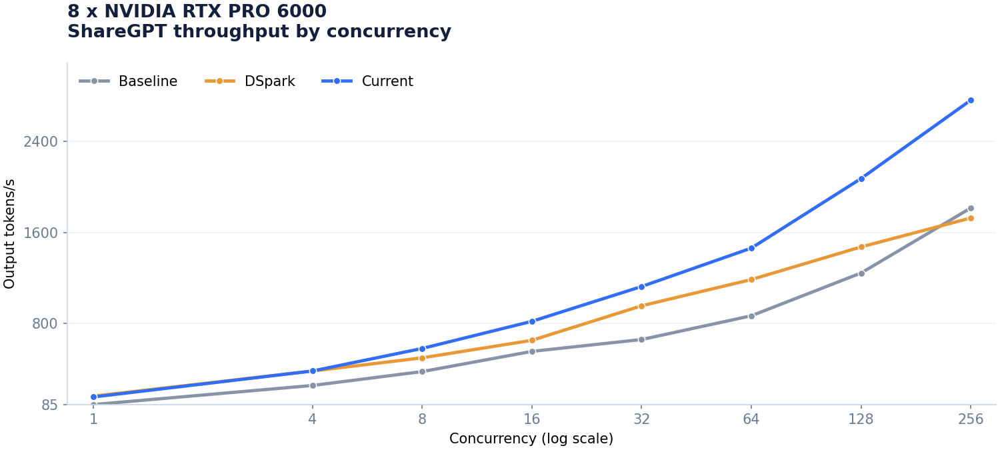
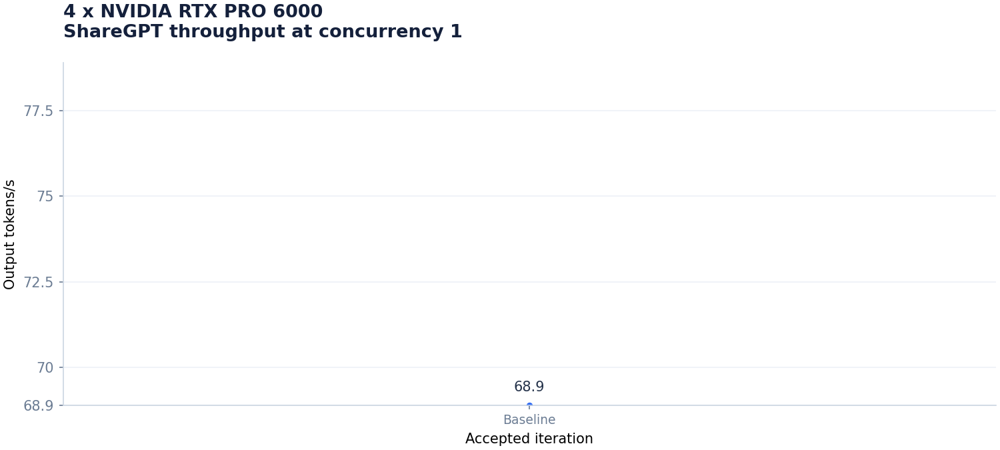

# DeepSeek-V4.1-Flash-RTX-PRO-6000

<table>
    <tr><td>Model</td><td><a href="https://huggingface.co/deepseek-ai/DeepSeek-V4.1-Flash-1017">DeepSeek-V4.1-Flash-1017</a></td></tr>
    <tr><td>Revision</td><td><a href="https://huggingface.co/deepseek-ai/DeepSeek-V4.1-Flash-1017/tree/1bae0e1088993b9b82de08f59de5be5a34e42170"><code>1bae0e1</code></a></td></tr>
    <tr><td>Hardware</td><td>NVIDIA RTX PRO 6000 (96 GB each)</td></tr>
    <tr><td>Architecture</td><td>sm120</td></tr>
    <tr><td>Precision</td><td>BF16 activations with native FP8 and MXFP4 weights</td></tr>
    <tr><td>Image</td><td><code>vllm/vllm-openai:v0.32.0</code></td></tr>
    <tr><td>Container</td><td><a href="https://github.com/users/alvarobartt/packages/container/package/vllm"><code>ghcr.io/alvarobartt/vllm:0.32.0-ds4.1-sm120</code></a></td></tr>
</table>

Benchmark commands and comparisons are in [`benchmarks/`](benchmarks/).

## 8 x NVIDIA RTX PRO 6000

```bash
docker run --rm \
    --gpus 8 \
    --network host \
    --ipc host \
    --ulimit memlock=-1 \
    -v "${HF_HOME:-$HOME/.cache/huggingface}:/root/.cache/huggingface" \
    -e HF_TOKEN \
    ghcr.io/alvarobartt/vllm:0.32.0-ds4.1-sm120 \
    deepseek-ai/DeepSeek-V4.1-Flash-1017 \
    --revision 1bae0e1088993b9b82de08f59de5be5a34e42170 \
    --tokenizer-mode deepseek_v41 \
    --tensor-parallel-size 8 \
    --max-model-len 1048576 \
    --tool-call-parser deepseek_v41 \
    --enable-auto-tool-choice \
    --reasoning-parser deepseek_v41 \
    --mm-encoder-tp-mode data \
    --block-size 64 \
    --speculative-config '{"method": "dspark", "num_speculative_tokens": 5, "revision": "1bae0e1088993b9b82de08f59de5be5a34e42170", "enable_adaptive_verification": true, "use_local_argmax_reduction": true}' \
    --enable-expert-parallel \
    --gpu-memory-utilization 0.965 \
    --max-num-batched-tokens 3840 \
    --compilation-config '{
        "max_cudagraph_capture_size": 768,
        "cudagraph_capture_sizes": [
            1, 2, 4, 6, 8, 12, 16, 24, 32, 40, 48, 56, 64, 72, 80, 88,
            96, 104, 112, 120, 128, 136, 144, 152, 160, 168, 176, 184, 192, 200, 208, 216,
            224, 232, 240, 248, 256, 272, 288, 304, 320, 336, 352, 368, 384, 400, 416, 432,
            448, 464, 480, 496, 512, 640, 768
        ]
    }'
```

| Concurrency | Baseline t/s [^8gpu-baseline] | Baseline + DSpark t/s | Current t/s |
|---:|---:|---:|---:|
| 1 | 85.0 | 159.2 (+87.3%) | **284.6 (+78.7%)** |
| 4 | 253.2 | 380.4 (+50.2%) | **686.2 (+80.4%)** |
| 8 | 375.4 | 496.2 (+32.2%) | **892.9 (+79.9%)** |
| 16 | 553.1 | 650.5 (+17.6%) | **1141.3 (+75.4%)** |
| 32 | 657.4 | 954.1 (+45.1%) | **1532.2 (+60.6%)** |
| 64 | 866.2 | 1185.0 (+36.8%) | **1974.3 (+66.6%)** |
| 128 | 1242.4 | 1471.9 (+18.5%) | **2545.0 (+72.9%)** |
| 256 | 1814.1 | 1726.3 (-4.8%) | **3179.3 (+84.2%)** |




See the detailed changelog in [`8-nvidia-rtx-pro-6000/CHANGELOG.md`](8-nvidia-rtx-pro-6000/CHANGELOG.md).

## 4 x NVIDIA RTX PRO 6000

```bash
docker run --rm \
    --gpus 4 \
    --network host \
    --ipc host \
    --ulimit memlock=-1 \
    -v "${HF_HOME:-$HOME/.cache/huggingface}:/root/.cache/huggingface" \
    -e HF_TOKEN \
    ghcr.io/alvarobartt/vllm:0.32.0-ds4.1-sm120 \
    deepseek-ai/DeepSeek-V4.1-Flash-1017 \
    --revision 1bae0e1088993b9b82de08f59de5be5a34e42170 \
    --tokenizer-mode deepseek_v41 \
    --tensor-parallel-size 4 \
    --max-model-len 1048576 \
    --tool-call-parser deepseek_v41 \
    --enable-auto-tool-choice \
    --reasoning-parser deepseek_v41 \
    --mm-encoder-tp-mode data \
    --block-size 64 \
    --enable-expert-parallel \
    --speculative-config '{"method":"dspark","num_speculative_tokens":5,"revision":"1bae0e1088993b9b82de08f59de5be5a34e42170","enable_adaptive_verification":true,"use_local_argmax_reduction":true}' \
    --gpu-memory-utilization 0.97 \
    --max-num-batched-tokens 4096 \
    --compilation-config '{
        "max_cudagraph_capture_size": 768,
        "cudagraph_capture_sizes": [
            1, 2, 4, 6, 8, 12, 16, 24, 32, 40, 48, 56, 64, 72, 80, 88,
            96, 104, 112, 120, 128, 136, 144, 152, 160, 168, 176, 184, 192, 200, 208, 216,
            224, 232, 240, 248, 256, 272, 288, 304, 320, 336, 352, 368, 384, 400, 416, 432,
            448, 464, 480, 496, 512, 528, 544, 560, 576, 592, 608, 624, 640, 656, 672, 688,
            704, 720, 736, 752, 768
        ]
    }'
```

| Concurrency | Baseline t/s [^4gpu-baseline] | Baseline + DSpark t/s | Current t/s |
|---:|---:|---:|---:|
| 1 | 68.9 | 131.3 (+90.8%) | **231.3 (+76.2%)** |
| 4 | 216.8 | 305.4 (+40.8%) | **534.4 (+75.0%)** |
| 8 | 317.3 | 450.0 (+41.8%) | **752.1 (+67.1%)** |
| 16 | 425.8 | 646.7 (+51.9%) | **1018.1 (+57.4%)** |
| 32 | 553.8 | 929.3 (+67.8%) | **1363.1 (+46.7%)** |
| 64 | 735.3 | 1216.4 (+65.4%) | **1666.3 (+37.0%)** |
| 128 | 1147.5 | 1779.2 (+55.0%) | **2241.0 (+26.0%)** |
| 256 | 1683.6 | 2090.1 (+24.1%) | **2882.4 (+37.9%)** |




See the detailed changelog in [`4-nvidia-rtx-pro-6000/CHANGELOG.md`](4-nvidia-rtx-pro-6000/CHANGELOG.md).

[^8gpu-baseline]: Baseline uses sm120 compatibility fixes, FlashInfer 0.7.1, and `--block-size 64`; stock vLLM failed before inference.
[^4gpu-baseline]: Baseline includes sm120 compatibility fixes, native FP8 KV-cache handling, grouped FP4 experts, and expert parallelism with DSpark disabled; the DSpark reference adds three adaptive draft tokens.
