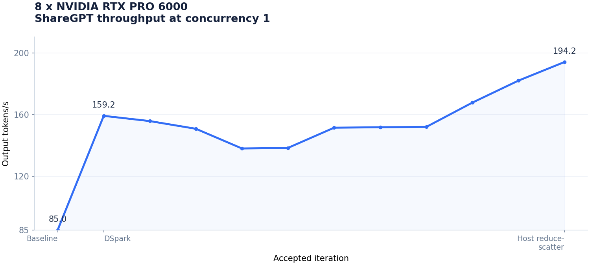
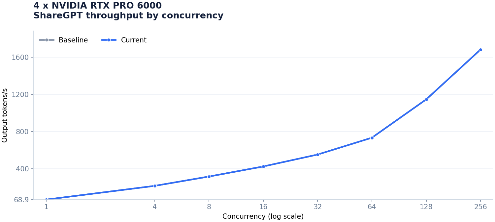

# DeepSeek-V4.1-Flash-RTX-PRO-6000

<table>
    <tr><td>Model</td><td><a href="https://huggingface.co/deepseek-ai/DeepSeek-V4.1-Flash-1017">DeepSeek-V4.1-Flash-1017</a></td></tr>
    <tr><td>Revision</td><td><a href="https://huggingface.co/deepseek-ai/DeepSeek-V4.1-Flash-1017/tree/1bae0e1088993b9b82de08f59de5be5a34e42170"><code>1bae0e1</code></a></td></tr>
    <tr><td>Hardware</td><td>NVIDIA RTX PRO 6000 (96 GB each)</td></tr>
    <tr><td>Architecture</td><td>sm120</td></tr>
    <tr><td>Precision</td><td>BF16 activations with native FP8 and MXFP4 weights</td></tr>
    <tr><td>Image</td><td><code>vllm/vllm-openai:v0.32.0</code></td></tr>
</table>

Validated serving recipes for four and eight GPUs, using the checkpoint's original weights and precision.

## 8 x NVIDIA RTX PRO 6000

| Concurrency | Baseline t/s [^8gpu-baseline] | Baseline + DSpark t/s | Current t/s |
|---:|---:|---:|---:|
| 1 | 85.0 | 159.2 (+87.3%) | **211.7 (+33.0%)** |
| 4 | 253.2 | 380.4 (+50.2%) | **534.8 (+40.6%)** |
| 8 | 375.4 | 496.2 (+32.2%) | **748.9 (+50.9%)** |
| 16 | 553.1 | 650.5 (+17.6%) | **1005.0 (+54.5%)** |
| 32 | 657.4 | 954.1 (+45.1%) | **1341.9 (+40.6%)** |
| 64 | 866.2 | 1185.0 (+36.8%) | **1649.4 (+39.2%)** |
| 128 | 1242.4 | 1471.9 (+18.5%) | **2194.5 (+49.1%)** |
| 256 | 1814.1 | 1726.3 (-4.8%) | **2998.3 (+73.7%)** |

See the detailed changelog in [`8-nvidia-rtx-pro-6000/CHANGELOG.md`](8-nvidia-rtx-pro-6000/CHANGELOG.md).

## 4 x NVIDIA RTX PRO 6000

| Concurrency | Baseline t/s [^4gpu-baseline] | Baseline + DSpark t/s | Current t/s |
|---:|---:|---:|---:|
| 1 | **68.9** | Not measured | **68.9** |
| 4 | **216.8** | Not measured | **216.8** |
| 8 | **317.3** | Not measured | **317.3** |
| 16 | **425.8** | Not measured | **425.8** |
| 32 | **553.8** | Not measured | **553.8** |
| 64 | **735.3** | Not measured | **735.3** |
| 128 | **1147.5** | Not measured | **1147.5** |
| 256 | **1683.6** | Not measured | **1683.6** |

See the detailed changelog in [`4-nvidia-rtx-pro-6000/CHANGELOG.md`](4-nvidia-rtx-pro-6000/CHANGELOG.md).

Run the requirements and full `vllm serve` command in the hardware changelog; each directory also includes a Dockerfile that retains the image's default entrypoint without model or parallelism defaults.

Measurements use `vllm bench serve` with ShareGPT, seed 0, temperature 0, dataset output lengths, and matching-concurrency warmups, with 128 measured prompts through c64, 256 at c128, and 512 at c256.

`benchmark.py` only sends benchmark requests to an existing server; run `python benchmark.py --help` for its model, dataset, endpoint, and output options.

Throughput is aggregate generated output tokens per second, including reasoning tokens; results depend on prompt lengths, cache state, and concurrency.

The measured model revision retains a 1,048,576-token context and 1,024 scheduler slots; the ShareGPT sweep does not measure performance at the full context length.

The recipes target this model, sm120 hardware, and vLLM version; the [Apache 2.0 license](LICENSE) covers this repository, and model weights retain their upstream terms.

[^8gpu-baseline]: Baseline uses sm120 compatibility fixes, FlashInfer 0.7.1, and `--block-size 64`; stock vLLM failed before inference.
[^4gpu-baseline]: Baseline includes sm120 compatibility fixes, native FP8 KV-cache handling, grouped FP4 experts, and expert parallelism with DSpark disabled; the DSpark reference adds three adaptive draft tokens.
